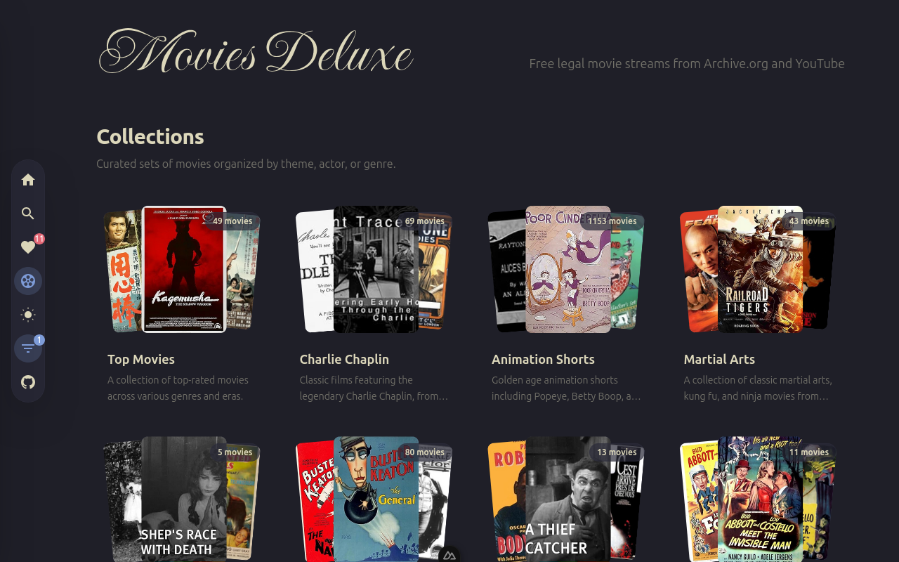
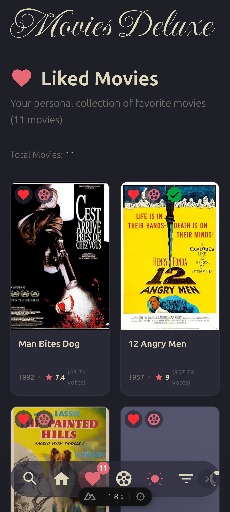
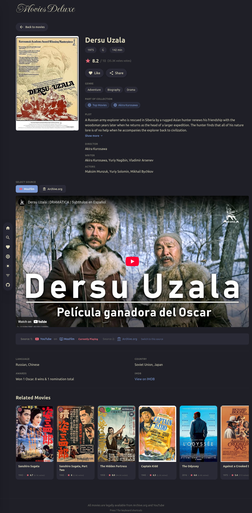
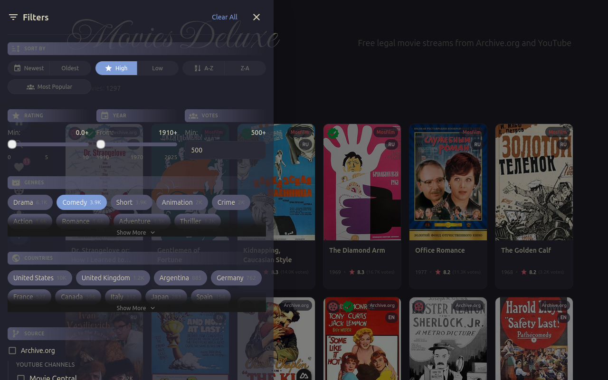
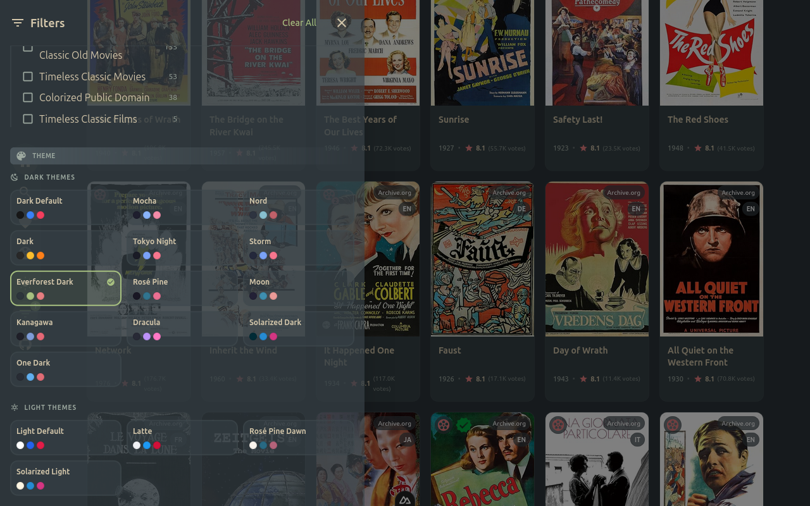
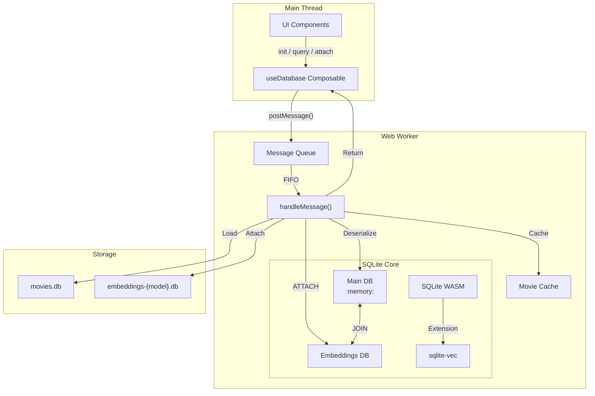
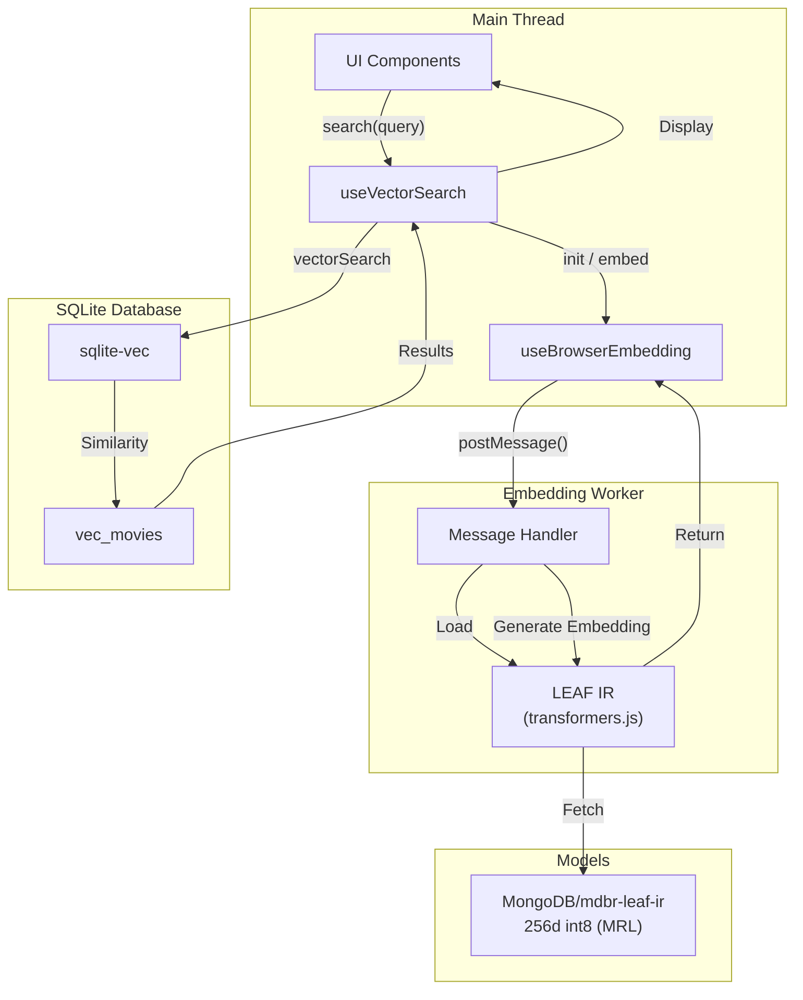
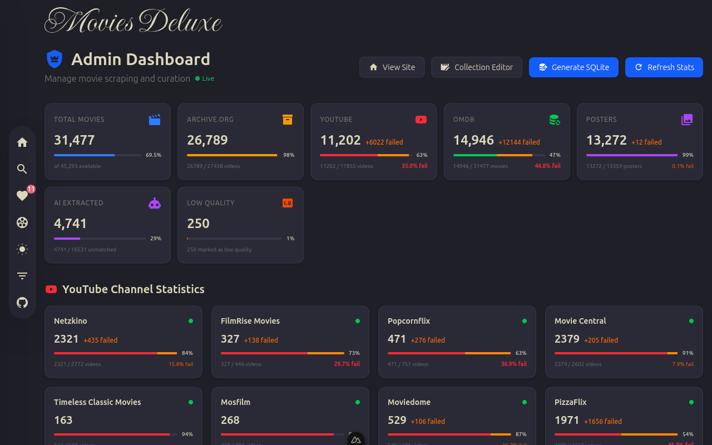
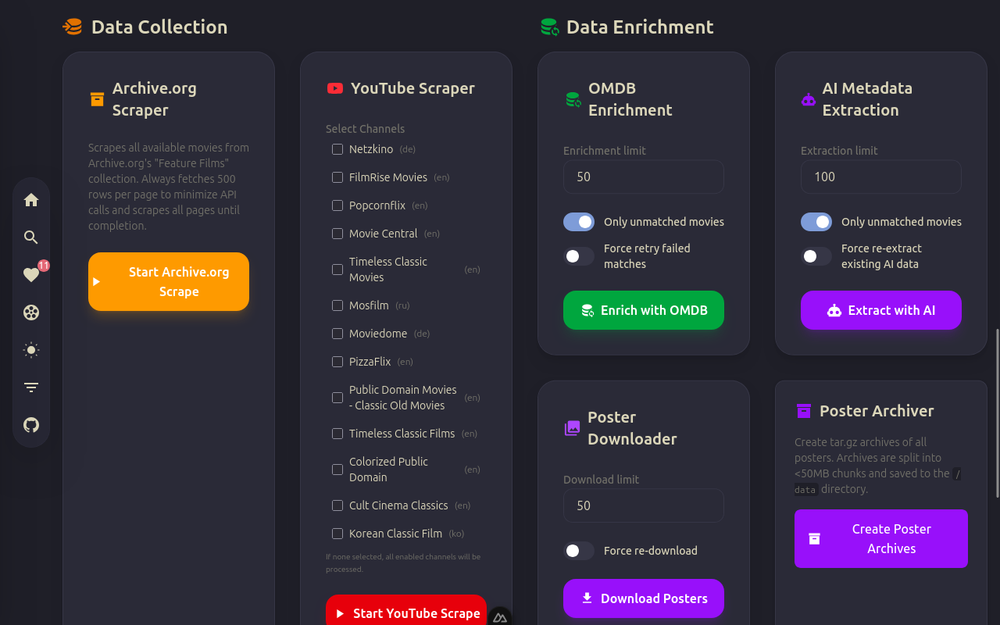
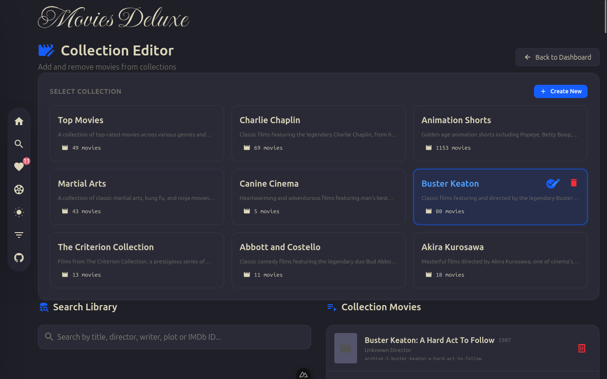

# Movies Deluxe

A Nuxt application for discovering and managing free legal movie streams.

Visit [Movies Deluxe](https://mdlx.org)

  

Filter, Sort, and Theme

 

## About

I dreamt about his project for while, but it flet too big to start. Finally this Christmas break 2025 I took the curage and started. I heavily relied on agentic development (as an additional learning goal) using [OpenCode](https://opencode.ai/) (with [Sonnet 4.5](https://aws.amazon.com/bedrock/anthropic/) and [Gemini 3 Flash](https://deepmind.google/models/gemini/flash/) and the [beads tracker](https://github.com/steveyegge/beads)). With this huge [amount of data](./public/data/stats.json) (31,477 movies) the curation and linking to the correct metadata is not easy and there are many wrong matches and "bad" entries like trailers and clips. Over time I will implement more data curation strategies, so please be patient.

## Change Log

For detailed information about recent updates and feature additions, please see the [CHANGELOG.md](./CHANGELOG.md).

## Tech Stack

This project is built with

- [Nuxt 4](https://nuxt.com/),
- [UnoCSS](https://unocss.dev/),
- [VueUse](https://vueuse.org/), and
- [Pinia](https://pinia.vuejs.org/).

The server API is exclusively used for local administration tasks for data collection, while the production build runs entirely client-side as a static site (GitHub Pages via `nuxt generate`) without a backend server. In production, movie data is queried using an in-browser SQLite database (`sqlite-wasm-vec`, SQLite WebAssembly + `sqlite-vec`) inside a Web Worker, enabling fast full-text (FTS5) and semantic vector search directly in the user's browser alongside static JSON files.

**[Embedding Models](./docs/embedding-models.md)**: Semantic search uses **`MongoDB/mdbr-leaf-ir`** (`leaf-ir`), running in-browser via `@huggingface/transformers` with 256D Matryoshka truncation and `int8` scalar quantization (`embeddings-leaf-ir-movies.db`). See the doc for model comparisons, quantization trade-offs, and research notes.

## AI Agent Support

Movies Deluxe is designed to be agent-friendly while remaining a pure static site with zero backend infrastructure:

- **WebMCP (`navigator.modelContext` / `document.modelContext`)**: In WebMCP-enabled browsers, `app/plugins/webmcp.client.ts` registers read-only client-side tools directly backed by the in-browser SQLite + vector search workers and static JSON files:
  - `search_movies` — FTS5 & filter search (`actor:`, `director:`, `writer:`, `title:` prefixes, genres, countries, sources, rating, year, votes, sort)
  - `semantic_search_movies` — natural-language plot/mood/theme search using `leaf-ir` + `sqlite-vec`
  - `get_movie_details` — full metadata, streaming sources, collections, and similar movies for a `movieId`
  - `list_collections` — list curated collections or inspect a specific collection's `movieIds`
- **`/llms.txt`**: [`public/llms.txt`](./public/llms.txt) (linked via `<link rel="describedby" href="/llms.txt" type="text/markdown">`) documents the static JSON endpoints (`/data/collections.json`, `/data/stats.json`, `/movies/<id>.json`, `/data/movies.db.gz`), `/search` URL query parameters, WebMCP tools, and the Agent Skill.
- **Agent Skill**: [`skills/movies-deluxe/SKILL.md`](./skills/movies-deluxe/SKILL.md) follows the [Agent Skills](https://agentskills.io/) format to teach CLI and coding agents how to query `mdlx.org` via static JSON endpoints, `movies.db.gz`, and `/search` URLs.
- **Shareable `/search` URLs**: `app/utils/searchUrlParams.ts` and `app/composables/useSearchUrlSync.ts` bidirectionally sync search state (`q`, `mode`, `genres`, `countries`, `source`, `year`, `rating`, `votes`, `sort`) with the URL query string so users and agents can deep-link directly to filtered or semantic search results.

### Architecture Diagrams

- **[SQLite Browser Architecture](./docs/architecture-sqlite-browser.md)**: Detailed architecture of the in-browser SQLite database including WebAssembly initialization, database worker with message queue, embeddings attach/detach pattern, query execution flow, and caching strategy.

- **[Embedding Generation & Vector Search](./docs/architecture-embedding-generation.md)**: Architecture for semantic search including the browser embedding worker (`MongoDB/mdbr-leaf-ir` via `@huggingface/transformers`), text preprocessing, `int8` quantization, and vector search with `sqlite-vec`.

#### SQLite Browser Architecture Flow



#### Embedding Generation & Vector Search Flow



### Data Sources

Data is collected via multiple APIs

- [Archive.org](https://archive.org/),
- [YouTube](https://www.youtube.com/),
- [OMDB](https://www.omdbapi.com/)

as well as with the help of a local LLM (using [Ollama](https://ollama.com/)). The curation of the data is done with various regexes, small algorithms and manually via the admin UI of this project.

## Setup

Install dependencies and set up data.

```bash
pnpm install
pnpm db:generate
pnpm posters:extract
```

### Database Generation Options

The `pnpm db:generate` command converts `data/movies.json` into `public/data/movies.db` (plus gzipped `movies.db.gz`) and individual `public/movies/<id>.json` files:

- `--skip-json`: Skip generating individual movie JSON files (faster if only the SQLite database needs updating).
- `-h, --help`: Show help message.

Example:

```bash
pnpm db:generate --skip-json
```

Embeddings (`public/data/embeddings-leaf-ir-movies.db`) are stored in a separate SQLite database file and generated via the Admin UI (`/admin`). For more details on embedding models, see the [Embedding Models Documentation](./docs/embedding-models.md).

### API Keys Setup

**[API Keys Setup](./docs/api-keys.md)**: Configuration guide for admin features requiring external API access.

## Project Structure

```
movies-deluxe/
├── app/                    # Frontend application (Nuxt 4, strict explicit imports)
│   ├── assets/             # Processed assets (images, SVGs)
│   ├── components/         # Vue components
│   ├── composables/        # Composables (useDatabase, useVectorSearch, useSearchUrlSync, ...)
│   ├── layouts/            # Layout components
│   ├── pages/              # File-based routing
│   ├── plugins/            # Nuxt plugins (WebMCP, dark mode, canonical, scroll restoration)
│   ├── stores/             # Pinia stores
│   ├── types/              # Frontend TypeScript types (including webmcp.d.ts)
│   ├── utils/              # Utility functions (searchQueryParser, searchUrlParams, leafIrEmbedding, ...)
│   └── workers/            # Web Workers (database.worker.ts, embedding.worker.ts)
├── config/                 # Configuration files (embedding-models.ts, youtube-channels.json)
├── data/                   # Raw data files
│   ├── movies.json         # Source movie database
│   ├── failed-*.json       # Failed operation tracking
│   └── posters-*.tar.gz    # Archived poster images
├── docs/                   # Project documentation
├── public/                 # Static assets (served at root)
│   ├── data/               # Generated static databases & JSON
│   │   ├── collections.json            # Curated movie collections
│   │   ├── embeddings-leaf-ir-movies.db # LEAF IR 256D int8 vector embeddings
│   │   ├── movies.db / movies.db.gz    # Client-side SQLite catalog + FTS5 index
│   │   └── stats.json                  # Database statistics and metrics
│   ├── llms.txt            # Machine-readable site guide for AI agents
│   ├── models/             # Browser ONNX embedding model assets (mdbr-leaf-ir)
│   ├── movies/             # Pre-generated per-movie JSON files (/movies/<id>.json)
│   ├── posters/            # Downloaded poster images
│   └── sqlite-wasm/        # SQLite WebAssembly + sqlite-vec files (sqlite-wasm-vec)
├── scripts/                # Maintenance and migration scripts
├── server/                 # Backend API (Nuxt server, localhost admin + prerender helpers)
│   ├── api/                # API endpoints (admin/*, movie/[id].get.ts)
│   ├── routes/             # Server routes (sitemap.xml.ts)
│   └── utils/              # Server utilities
├── shared/                 # Code shared between frontend and backend
│   ├── types/              # Shared TypeScript types
│   └── utils/              # Shared utility functions
└── skills/                 # Agent Skills (agentskills.io)
    └── movies-deluxe/      # SKILL.md for querying mdlx.org from CLI/coding agents
```

## Admin Dashboard

The admin dashboard started of as individual scripts that were migrated to server API endpoints. Progress is reported via [SSE](https://en.wikipedia.org/wiki/Server-sent_events) in real time since the actions can take from minutes to multiple days.

The dashboard can only be reached on `localhost` at `/admin`.

  
